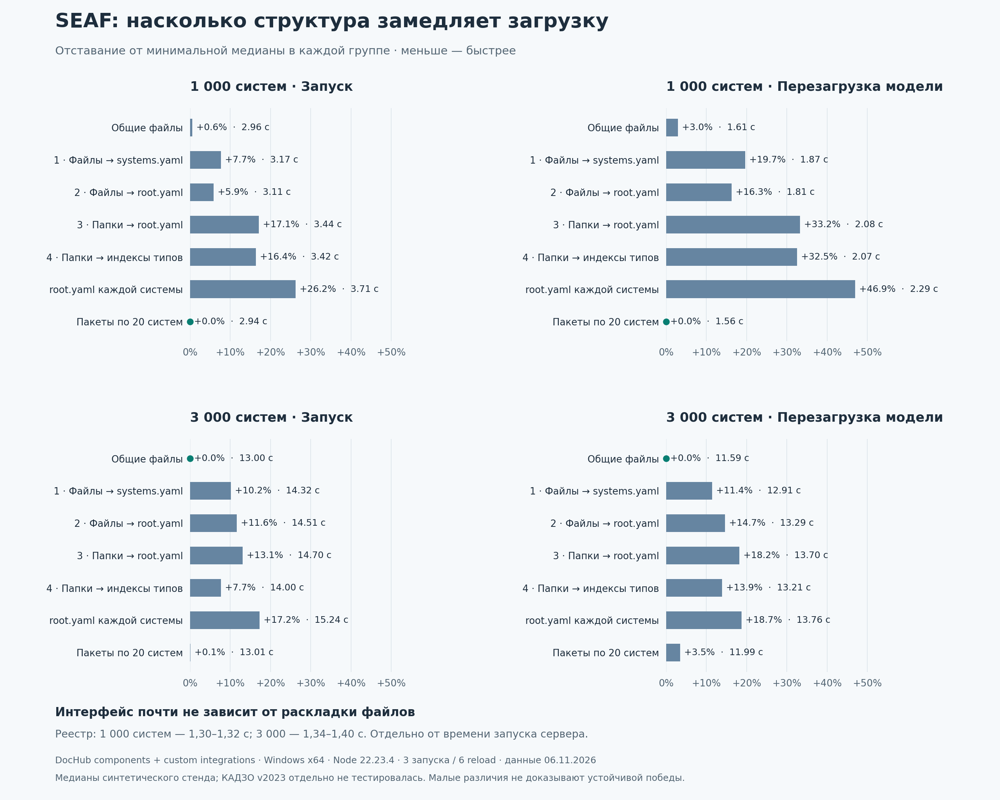

# SEAF: краткий результат нагрузочного исследования

Сравнены семь структур с одинаковой синтетической моделью DocHub components + custom integrations: 1000/3000 систем и 3000/9000 интеграций. Windows native, Node 22.23.4, три process-повтора и шесть reload на вариант. КАДЗО v2023 и корпоративные правила отдельно не тестировались; приведённые проценты не являются измерением КАДЗО.

**Единого победителя нет.** На 1000 систем минимальные медианы старта и reload у пакетов по 20 систем. На 3000 — у общих файлов; старт пакетов отличается лишь на 0,07%, reload — на 3,46%. Эти небольшие различия не доказывают устойчивого преимущества.

**Рекомендация по хранению:** простые системы группировать по области ответственности; для сложной LTI — своя папка с root.yaml, системами, функциями, исходящими интеграциями и представлениями. Общие справочники подключать один раз. Номер 20 — проверенный размер пакета, не универсальный оптимум.

## Насколько медленнее минимальной медианы

| Структура | 1000: старт | 1000: reload | 3000: старт | 3000: reload |
|---|---:|---:|---:|---:|
| Общие файлы | +0.6% | +3.0% | Минимум | Минимум |
| 1 · Файлы → systems.yaml | +7.7% | +19.7% | +10.2% | +11.4% |
| 2 · Файлы → root.yaml | +5.9% | +16.3% | +11.6% | +14.7% |
| 3 · Папки → root.yaml | +17.1% | +33.2% | +13.1% | +18.2% |
| 4 · Папки → индексы типов | +16.4% | +32.5% | +7.7% | +13.9% |
| root.yaml каждой системы | +26.2% | +46.9% | +17.2% | +18.7% |
| Пакеты по 20 систем | Минимум | Минимум | +0.1% | +3.5% |

Формула: `(время варианта / минимальное время той же операции и размера − 1) × 100%`. Значение «+46,9%» означает в 1,469 раза дольше, а не снижение пропускной способности на 46,9%.

## Что влияет на работу пользователя

- Открытие реестра: 1,30–1,32 с на 1000 систем и 1,34–1,40 с на 3000. Дробление файлов не дало заметного выигрыша в этом сценарии.
- При HTTP-импортах цена тысяч файлов выше: в отдельном тесте 1000 систем / 10 мс на запрос reload с manifest каждой системы занял 4,807 с против 1,607 с у общих файлов — примерно в 3 раза дольше. Это не измерение реального GitLab; локальный Git-клон относится к файловому профилю.
- CPU profile выявил горячий wildcard-валидатор: wcard занял 22,14% sampled time. Структура выражения предполагает N² сравнений явных ID; перестановка файлов эту стоимость не устраняет. Оптимизация не внедрялась в рамках исследования.
- Полная схема 3000 узлов, concurrent users/RPS, cold disk и корпоративные validators не тестировались. Фокусная схема — PlantUML 50 узлов; SmartAnts smoke завершился ошибкой и сохранён отдельно.

[Полный отчёт](REPORT.md) · [Медианы CSV](measurements.csv) · [Отставание CSV](slowdown.csv)
