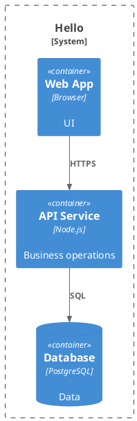

# Как создать схему и C4 L2

В этой инструкции **L2 — контейнерный уровень C4**: приложения и хранилища внутри одной системы, их обязанности, технологии и взаимодействия. Это архитектурный уровень; Docker для него не требуется. Определение: [официальная C4 Container diagram](https://c4model.com/diagrams/container).

## Обычная схема SEAF

1. Опишите компоненты с ID, title, entity и links. Сохраните родителей ID и реальные получатели связей.
2. Создайте контекст и импортируйте файл в корневой манифест:

```yaml
contexts:
  demo.hello.l2:
    title: Hello — L2
    location: Примеры/Hello/L2
    presentation: smartants
    extra-links: false
    components:
      - demo
      - demo.hello
      - demo.hello.web
      - demo.hello.api
      - demo.hello.db
```

3. Проверьте модель и откройте контекст через меню **Архитектура → Контексты**. Допустимы `presentation: smartants` и `presentation: plantuml`. Конкретная location добавляется к root_menu контекстов.

## Как получить L2

Используйте `demo.hello` как границу системы, `.web` — UI, `.api` — приложение, `.db` — БД. Укажите назначения в description, стек в принятом поле технологии и подписи связей. Выбирайте один и тот же набор ID на диаграмме и в источниках. Для ShopFlow L2 раскрывает gateway, микросервисы, брокер и их хранилища; исходники — `architecture/components.yaml` и `architecture/contexts.yaml`.

SEAF не определяет уровень автоматически по имени контекста: надпись L2 сама не фильтрует компоненты. Маска `demo.hello.*` удобна, но может включить будущие дочерние элементы; для фиксированной L2 используйте явный список. Иерархия ID помогает группировке, но не заменяет определения границ/ответственности C4.

## Готовая схема в нотации C4

В Hello откройте **Примеры → Hello → C4 L2**. Файл `diagrams/l2.puml` использует библиотеку, уже встроенную в локальный PlantUML; загрузка с GitHub не нужна:



Для такого файла описание документа: `type: plantuml`, `source: diagrams/l2.puml`. Это отдельная вручную поддерживаемая C4-схема; контекст выше строится из архитектурной модели. При изменении API/БД синхронизируйте оба представления. Проверенный локальный renderer использует SANDBOX; внешние URL/include не разрешаются.

## Рисунок или модель

- **Контекст:** строится из components/links; изменение модели меняет схему после reload.
- **draw.io:** откройте или импортируйте XML, проверьте распознанные компоненты и соответствия ID. Сохранение layout не переписывает весь проект. Не каждый элемент рисунка становится сущностью автоматически.
- **Mermaid/PlantUML документ:** отдельный текстовый артефакт. Изменение links не синхронизирует его сценарий автоматически.

Нативный профиль строит PlantUML и SmartAnts локально. Обычный SEAF-контекст показывает модель на уровне L2; для строгих C4-символов используйте приведённый отдельный документ.

Источник: `entities/contexts/base.yaml`, `examples/shopflow/architecture/contexts.yaml`, `examples/hello/architecture.yaml`.
